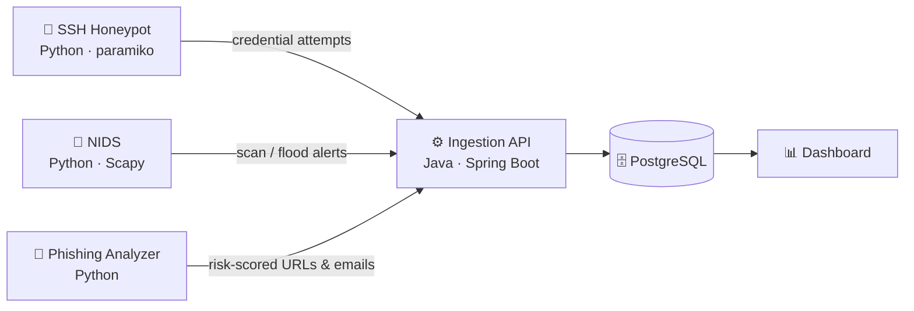

<div align="center">

# 🛡️ mini-SIEM

**A lightweight Security Information and Event Management platform that correlates alerts from an SSH honeypot, a packet-level NIDS and a phishing analyzer, all in one real-time dashboard.**


</div>

---

## Why this project

Security tools are usually studied in isolation. This project connects three of them, built from scratch, into a single pipeline: **collect → centralize → correlate → visualize**. It mirrors, at a small scale, how a real SOC ingests and triages events.

## Architecture



## Event sources

| Source | What it detects | How it works | MITRE ATT&CK |
|---|---|---|---|
| **SSH Honeypot** | Credential guessing against a fake SSH service | Real SSH protocol via `paramiko`, multi-threaded, logs IP, username and password | [T1110](https://attack.mitre.org/techniques/T1110/) Brute Force |
| **NIDS** | Port scans (10+ distinct ports from one IP) and SYN floods (50+ SYN packets) | Live packet capture and analysis with Scapy | [T1046](https://attack.mitre.org/techniques/T1046/) Network Service Discovery, [T1498.001](https://attack.mitre.org/techniques/T1498/001/) Direct Network Flood |
| **Phishing Analyzer** | Suspicious URLs and `.eml` emails | Risk scoring (low / medium / high) from typosquatting, domain age, SSL and redirects | [T1566](https://attack.mitre.org/techniques/T1566/) Phishing |

Each source lives in its own repository:
[`honeypot-ssh`](https://github.com/VitoriaChuarts/honeypot-ssh) · [`nids-python`](https://github.com/VitoriaChuarts/nids-python) · [`analisador-de-phishing`](https://github.com/VitoriaChuarts/analisador-de-phishing)

## Dashboard

<div align="center">

</div>

## Getting started

**Requirements:** Java 17+, Docker, Python 3.10+ (for the event sources)

```bash
# 1. Clone the repository
git clone https://github.com/VitoriaChuarts/mini-siem.git
cd mini-siem

# 2. Start PostgreSQL
docker-compose up -d

# 3. Run the backend
cd backend
./mvnw spring-boot:run
```

Then open the dashboard in your browser and start any of the event sources to see alerts arrive in real time.

## Project structure

```
mini-siem/
├── backend/          # Spring Boot ingestion API
├── docker-compose.yml  # PostgreSQL
└── docs/             # screenshots and demo
```

## Roadmap

- [ ] Dashboard authentication
- [ ] Rule-based detection with YAML rules mapped to MITRE ATT&CK (see Detection Engineering Lab)
- [ ] Automated response actions

## ⚠️ Responsible use

Built for learning and portfolio purposes. Run the honeypot and attack simulations only in **isolated lab environments** you own or have permission to test.

## Author

**Vitória Chuarts**, Software Engineering student (Uniube) focused on full stack and security.
[LinkedIn](https://www.linkedin.com/in/vitória-chuarts-687b26191) · [vitoriachuarts@icloud.com](mailto:vitoriachuarts@icloud.com)
