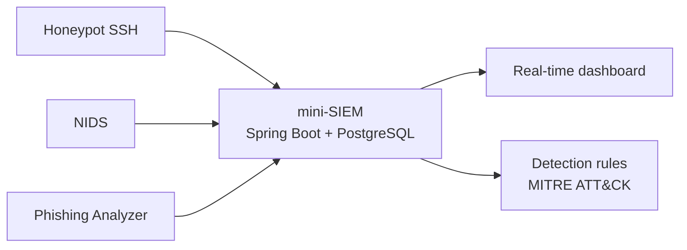

<table>
<tr>
<td width="220" align="center">


</td>
<td>

# Vitória Chuarts


Software Engineering student · Java · Python · Security

[](https://www.linkedin.com/in/vitória-chuarts-687b26191)
[](mailto:vitoriachuarts@icloud.com)

</td>
</tr>
</table>

```text
vitoria@kali:~$ whoami
Vitória Chuarts · Software Engineering student at Uniube (Brazil)

vitoria@kali:~$ cat focus.txt
> Full stack development with Java and Spring Boot
> Detection engineering: honeypots, NIDS and SIEM
> Open to relocation
> Languages: Portuguese (native) · Spanish (advanced) · English (intermediate)
```

## How I build security tools



## Flagship project

**[mini-SIEM](https://github.com/VitoriaChuarts/mini-siem)** correlates alerts from an SSH honeypot, a packet-level NIDS and a phishing analyzer in a single real-time dashboard.
`Java` `Spring Boot` `PostgreSQL` `Docker`

<!-- Quando o docs/demo.gif estiver no repositório mini-siem, apague esta linha e a última deste comentário:
[](https://github.com/VitoriaChuarts/mini-siem)
-->

## Security projects

| Project | What it does | Stack |
|---|---|---|
| [**honeypot-ssh**](https://github.com/VitoriaChuarts/honeypot-ssh) | Fake SSH server that captures attacker credentials | Python, paramiko |
| [**nids-python**](https://github.com/VitoriaChuarts/nids-python) | Detects port scans and SYN floods from live packets | Python, Scapy |
| [**analisador-de-phishing**](https://github.com/VitoriaChuarts/analisador-de-phishing) | Risk scoring for URLs and `.eml` emails | Python |

## Tech stack


## Currently building

`Detection Engineering Lab`: YAML rule engine mapped to MITRE ATT&CK, with automated response.
