<br/>

<table align="center">
<tr>
<td width="42%">
  
</td>
<td>

```
$ whoami
vitoria_chuarts

$ cat perfil.txt
> cyber + full stack
> kali · python · fastapi
> status: online ♡

$ ls projetos/
scanner-de-senhas
analisador-de-senha
analisador-de-phishing
honeypot-ssh
```

</td>
</tr>
</table>

<p align="center">
  
</p>

<p align="center">
  
</p>


Estudante de **Engenharia de Software** que constrói **e** protege aplicações: do backend à interface, do código ao histórico do Git. Gosto de transformar ataque em aprendizado, e aprendizado em projeto. ✦


<p align="center">
  
</p>

<p align="center">
  
  
  
  
  
  
  
</p>


| Projeto | O que faz | Tech |
|---|---|---|
| 🎀 [honeypot-ssh](https://github.com/VitoriaChuarts/honeypot-ssh) | Honeypot SSH feito do zero: simula um servidor, captura credenciais de atacantes e gera relatório com top senhas, usuários e IPs | Python · paramiko |
| 🔐 [scanner-de-senhas](https://github.com/VitoriaChuarts/scanner-de-senhas) | Detecta credenciais expostas no código e no histórico do Git | Python · Git |
| 🔑 [Analisador-de-senha](https://github.com/VitoriaChuarts/Analisador-de-senha) | Audita a força de senhas | Python |
| 🎣 [analisador-de-phishing](https://github.com/VitoriaChuarts/analisador-de-phishing) | API + interface com pontuação de risco para URLs e e-mails | Python · FastAPI |





<picture>
  <source media="(prefers-color-scheme: dark)" srcset="https://raw.githubusercontent.com/VitoriaChuarts/VitoriaChuarts/output/github-snake-dark.svg?v=4">
  <source media="(prefers-color-scheme: light)" srcset="https://raw.githubusercontent.com/VitoriaChuarts/VitoriaChuarts/output/github-snake.svg?v=4">
  
</picture>

<p align="center">
  
  
  
</p>


<p align="center">
  <a href="https://www.linkedin.com/in/vit%C3%B3ria-chuarts-687b26191"></a>
  <a href="mailto:vitoriachuarts@icloud.com"></a>
</p>


